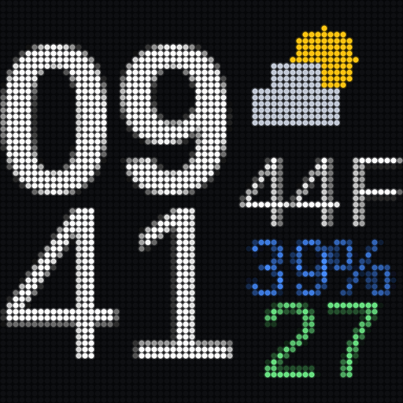

# tuneshine-info

Show a clock and the local weather on every Tuneshine on your network.



*The panel simulation: 64x64, rendered at 09:41 with night dim off.*

A Tuneshine is a small 64x64 LED display made for album art. This tool uses the
device's local HTTP API to take over its idle screen: when no music is playing,
the display shows the time, a weather icon, the temperature, the chance of rain
and the air quality index. The moment music starts, the album art comes back on
its own. When playback stops, the clock returns.

## What it does

- Finds every Tuneshine on the LAN by itself, over mDNS. No IP addresses to
  configure.
- Renders one 64x64 frame and pushes it to each device every minute.
- Leaves a device alone while it is playing music, so album art is never
  interrupted.
- Dims the frame by half between sunset and sunrise, then restores it.
- Picks the weather icon from the current conditions, and shows a moon at night
  when the sky is clear.
- Keeps working when data is missing. A failed weather request shows `--` rather
  than a wrong number, and the clock always renders.

## Requirements

- Python 3.8 or newer.
- Two packages: `pillow` and `requests`.
- A machine that stays on, on the same network as the Tuneshine. See
  [The pushing machine must stay online](#the-pushing-machine-must-stay-online).
- No API keys. Weather comes from [Open-Meteo](https://open-meteo.com/), which is
  free and needs no signup. Location is found from your public IP unless you
  pin it.

## Install

```sh
git clone https://github.com/tsella/tuneshine-info.git
cd tuneshine-info

python3 -m pip install pillow requests

# optional but recommended: use a virtualenv
# python3 -m venv .venv && . .venv/bin/activate && pip install pillow requests
```

Copy the example config and check that the device is found:

```sh
mkdir -p ~/.config/tuneshine
cp config.example.json ~/.config/tuneshine/config.json

python3 tuneshine_info.py --list-devices
```

You should see one line per Tuneshine, with its name, IP, MAC address, hostname
and firmware version.

Render a frame without touching the device:

```sh
python3 tuneshine_info.py --preview
```

That writes the exact 64x64 buffer to `preview.png`. To also see it as the
panel will show it:

```sh
python3 tuneshine_info.py --preview --simulate
```

which adds `preview-panel.png` beside it.

If that looks right, push one frame for real:

```sh
python3 tuneshine_info.py --force
```

Then add the cron entry. See [Cron](#cron).

## Configuration

The config lives at `~/.config/tuneshine/config.json`. Override the path with
`--config FILE`, or point `$TUNESHINE_CONFIG` at it.

```sh
python3 tuneshine_info.py --init-config
```

writes the defaults. The file is optional: a missing or malformed config falls
back to the built-in defaults, and an unknown or invalid value is ignored with a
line in the log.

| Key | Default | Meaning |
|---|---|---|
| `devices.mode` | `"all"` | Which devices to push to. See [Choosing devices](#choosing-devices). |
| `devices.include` | `[]` | Device identifiers, used when mode is `include`. |
| `devices.exclude` | `[]` | Device identifiers, used when mode is `exclude`. |
| `devices.hosts` | `[]` | Extra hosts to try, for networks that block multicast. An entry may carry a port, such as `10.0.0.5:8080`. |
| `devices.mdns` | `true` | Set `false` to skip discovery and use `devices.hosts` only. |
| `devices.mdns_timeout` | `4` | Seconds to listen for mDNS answers. |
| `location` | `"auto"` | `auto` finds the location from your public IP. `pinned` uses `lat`/`lon`. |
| `lat`, `lon` | `40.7128`, `-74.0060` | Coordinates for `pinned`, and the fallback when `auto` fails. |
| `label` | `""` | A name for the location. Used in `--status` only. |
| `units` | `"fahrenheit"` | `fahrenheit` or `celsius`. Sets the letter shown with the temperature. |
| `clock` | `"24h"` | `24h` or `12h`. |
| `timezone` | `"local"` | `local`, or an IANA name such as `America/New_York`. |
| `frame_brightness` | `100` | 1 to 100. Scales this frame's pixels only. |
| `night_dim.enabled` | `true` | Dim the frame between sunset and sunrise. |
| `night_dim.percent` | `50` | Percentage **of** `frame_brightness`, not of full. `0` renders a black frame, so the panel is dark overnight. |
| `antialias` | `true` | Blend glyph edges. `false` gives hard, single-colour pixels. |
| `brightness.set` | `false` | `true` also writes idle/active brightness to the device. |
| `brightness.idle`, `brightness.active` | `50`, `50` | Values used when `brightness.set` is true. |
| `weather_ttl` | `600` | Seconds a weather reading stays fresh. |
| `location_ttl` | `86400` | Seconds an IP geolocation result is reused. |
| `stale_after_seconds` | `1800` | Older weather than this renders dimmed. |
| `alert_ttl` | `21600` | Minimum seconds between failure messages. |
| `state_dir` | `~/.cache/tuneshine-info` | Where the log, state and preview PNG live. The log rotates at 1 MB, keeping one backup. |
| `font_bold`, `font_reg` | Liberation Sans | Font files for the time and the weather column. If the configured file is missing, a list of common system fonts is tried and the substitution is logged. |

`night_dim.percent` is a percentage of `frame_brightness`. With
`frame_brightness: 60` and `night_dim.percent: 50`, the night value is 30, not
50.

Set `night_dim.percent` to `0` to turn the panel off overnight: the frame is
rendered fully black and pushed as usual, so the display stays dark until sunrise
and the device keeps its normal idle behaviour. At `0` the night frame is a
40-byte WebP instead of roughly 1.5 kB.

## Choosing devices

By default the frame goes to every Tuneshine found.

To push to a few only:

```json
"devices": {
  "mode": "include",
  "include": ["Kitchen", "tuneshine-89B8.local"]
}
```

To push to all but a few:

```json
"devices": {
  "mode": "exclude",
  "exclude": ["*Bedroom*"]
}
```

A list entry can name any of these:

- the device name, as set in the Tuneshine app
- the hardware ID, or MAC address, with or without colons
- the `deviceId` from the mDNS record
- the IP address
- the hostname, such as `tuneshine-89B8.local`
- the mDNS instance name

Matching ignores case and MAC punctuation, and accepts shell globs, so
`*Bedroom*` and `80:65:99:*` both work. Run `--list-devices` to see the exact
values for your devices. That command also prints which devices are selected and
which are filtered out, so you can check a rule before trusting it.

If `mode` is `include` and the list is empty, the tool pushes to all devices and
logs a warning, rather than silently doing nothing.

## Cron

Copy `crontab.example` and edit the path:

```sh
crontab -e
```

```cron
* * * * * /usr/bin/python3 /opt/tuneshine-info/tuneshine_info.py >/dev/null 2>&1
```

Once a minute is enough, because the display only shows minutes. Use an absolute
path to `python3`; cron's `PATH` is minimal.

If you run [Hermes](https://github.com/NousResearch/hermes-agent) or another
scheduler, use the same command. The script is quiet on success, so it fits a
watchdog style job: it prints nothing unless something has failed, and it prints
again when it recovers.

## The pushing machine must stay online

The Tuneshine does not fetch this itself. This tool renders the frame and pushes
it to the device over the network, once a minute.

So the machine running the cron job has to be up and on the same network. If it
is asleep or off, nothing is pushed and the display keeps the last frame it
received, with the time frozen at whatever minute it showed last. Nothing breaks
and nothing is lost. The display simply stops updating until the machine comes
back and the job runs again.

This is also why the tool works with the device's own artwork instead of fighting
it. The frame is uploaded as an idle image, so the device shows it only when it
has nothing better to show, and it keeps the device's normal behaviour intact.

## How it works

The Tuneshine exposes a small HTTP API on the LAN and advertises itself over mDNS
as `_tuneshine._tcp.local`. This tool:

1. Queries mDNS for every instance, and reads each device's `/state`.
2. Renders one 64x64 frame.
3. Uploads it to each selected device with the metadata
   `{"idle": true, "overridable": true}`, which tells the device to show it when
   idle and to let album art win when music plays.
4. Checks `remoteMetadata.idle` first. If a device is playing, it is skipped.

Weather comes from two Open-Meteo endpoints: the forecast API for the
temperature, weather code, rain probability and sunrise/sunset, and the air
quality API for the US AQI. A code is mapped to a drawn icon: sun, moon, partly
cloudy, cloud, fog, drizzle, rain, snow or thunder.

Text is rasterised to a coverage mask and blended into the black background, so
glyph edges look the way they do in a normal high-resolution render rather than
as hard blocks. Set `antialias` to `false` if you prefer hard pixels.

## Troubleshooting

`--list-devices` finds nothing:

- Make sure the Tuneshine is powered on and joined to the same network.
- Some networks block multicast. Put the device's IP or hostname in
  `devices.hosts` and it will be tried directly.
- On a machine with several interfaces, multicast may leave by the wrong one.

The display does not change:

- Check the log at `<state_dir>/tuneshine_info.log`.
- Run `--status`. If a device shows `playing=true`, it is playing music and is
  being left alone on purpose.
- Run `--preview`. It reports which devices would be pushed to.

The log says `no usable font`:

- Neither the configured font nor any fallback exists on this machine. Point
  `font_bold` and `font_reg` at a `.ttf` file it does have.

`.local` hostnames do not resolve:

- This is common on Linux without `nss-mdns`, and it does not matter. Discovery
  uses multicast directly. Use IP addresses in `devices.hosts` if you need to
  name a host explicitly.

## Tests

```sh
python3 test_tuneshine_info.py
```

The suite is offline. It never contacts a Tuneshine, the network or the weather
APIs: mDNS packets are built by hand, the HTTP calls are stubbed, and every state
path goes to a temporary directory. The tests that must prove something
*terminates* — the mDNS pointer-loop guard and the lock race — run in
subprocesses, because a test that can hang cannot be trusted to finish in its own
process.

## Credits

Thanks to the maker of Tuneshine. It is a genuinely nice little device, and
opening a local HTTP API with a documented OpenAPI spec at `/openapi.json` is
exactly the right call. A wall display that answers to its owner is a much more
interesting object than one that only talks to a cloud service, and this tool
exists because that door was left open. If you like what this does, go buy one:
[tuneshine.rocks](https://tuneshine.rocks).

Weather data by [Open-Meteo](https://open-meteo.com/), which is free for
non-commercial use and needs no API key.

## License

MIT. Copyright (c) 2026 Tom Sella. See [LICENSE](LICENSE).
